  

# 🤖 Awesome Android Hardware & Accessories SDK Ecosystem

**Curated list of leading SaaS / Hosted Device Farms, Open-Source Android Hardware Accessories SDKs, USB OTG / BLE drivers, WebUSB ADB tools, and AI Agentic automation platforms.**

---

## 📌 Introduction & Scope

Welcome to the **Awesome Android Hardware & Accessories SDK** catalog. This repository indexes the most comprehensive collection of **enterprise SaaS platforms** and **active open-source GitHub repositories** enabling developers, hardware engineers, QA teams, and embedded specialists to interface with:

* 📱 **Physical Android Device Farms**: Remote test execution, browser streaming, and multi-device QA labs.
* 🔌 **USB OTG & Serial Accessories**: Serial bus bridges (FTDI, CP210x, CH340, Arduino) and Android Open Accessory (AOA) protocols.
* 📶 **Bluetooth Low Energy (BLE) & IoT**: Robust GATT queues, bonding managers, wearable connectivity, and sensor data pipelines.
* ⚡ **Remote ADB & WebUSB Streaming**: Zero-install browser mirroring, touch/keyboard forwarding, and direct ADB over SSL/WebSockets.
* 🤖 **Agentic Hardware Control & Testing**: Autonomous AI agents controlling physical and virtual devices via modern SDKs and tools.

---

## 📑 Table of Contents

- [📊 Sector Overview & Market Dynamics](#-sector-overview--market-dynamics)
- [☁️ SaaS & Hosted Device Platforms](#️-saas--hosted-device-platforms)
- [💻 Open-Source GitHub Projects](#-open-source-github-projects)
- [🤝 How to Contribute](#-how-to-contribute)
- [⭐ Star History](#-star-history)
- [💖 Support & Community](#-support--community)
- [⚠️ Disclaimer](#️-disclaimer)

---

## 📊 Sector Overview & Market Dynamics

The global mobile app testing and cloud device farm sector is estimated at **$8B – $12B**, expanding rapidly at a CAGR of 16–17.5% driven by continuous testing and mobile hardware fragmentation. The market exhibits an **oligopoly-leaning concentration at the cloud device infrastructure layer** (dominated by hyperscalers like AWS/Google and specialized leaders like BrowserStack and Sauce Labs due to heavy hardware Capex), while remaining **moderately-to-highly fragmented across test execution frameworks, developer utilities, and open-source tooling**.

---

## ☁️ SaaS & Hosted Device Platforms

The following enterprise cloud services offer hosted physical Android device farms, cloud IDEs, and device hardware simulation:

| Platform | Company Valuation / Revenue | Starting Pricing Tier | Free Tier Limits / Free Trial | Description |
|---|---|---|---|---|
| **[AWS Device Farm](https://amazon.com)** | **$2.15T+ Market Cap** / $107B+ AWS Rev | $0.17 / device minute (Pay-as-you-go) or $250/month per unmetered device slot | **Free Trial**: One-time 1,000 device minutes trial for new accounts (no recurring monthly free tier) | Cloud-based app testing service providing remote access to real physical Android phones, tablets, and hardware configurations. |
| **[Android Studio Cloud (Firebase Device Streaming)](https://android.com)** | **$2.10T+ Market Cap** / $307B+ Alphabet Rev | $0.15 / minute on Pay-as-you-go (Blaze Plan); Virtual test lab at $1.00/device-hr | **Free Plan**: Free tier on Firebase Spark plan with up to 120 device streaming minutes/month (and 10 virtual tests/day on Test Lab) | Google-hosted cloud IDE and remote device streaming environment for building, debugging, and testing Android apps on physical hardware via direct ADB over SSL. |
| **[Google Play Console (Device Catalog & Pre-Launch Reports)](https://google.com)** | **$2.10T+ Market Cap** / $307B+ Alphabet Rev | $25 one-time registration fee (no recurring monthly platform subscription) | **Free Plan**: Free forever unlimited access to automated Pre-Launch Reports, Device Catalog, and crash analytics for all uploaded APKs/AABs | Official distribution and hardware compatibility platform providing automated physical device testing, crash diagnostics, and hardware targeting across the Android device ecosystem. |
| **[Samsung DeX Developer](https://samsung.com)** | **$340B+ Market Cap** / ~$198B Rev | Completely free for registered developers ($0 / month) | **Free Plan**: Free forever access to DeX guidelines, multi-window SDKs, dual-mode APIs, and Samsung Remote Test Lab credits | SDK, guidelines, and testing ecosystem for optimizing Android applications for external monitors, desktop mode, and keyboard/mouse accessories. |
| **[ADB Cloud / Remote TestKit](https://appkitbox.com)** | **~$90B+ NTT Group Rev** / ~$10.2M unit rev | $490 / month (Flat 1 Plan: 1 concurrent device rental, minimum 3-month commitment) | **Free Trial**: Evaluation trial available upon request, capped at 2 hours total (approx. 4 device sessions) | Hosted cloud infrastructure by NTT providing direct remote ADB connections to physical Android devices for hardware-level debugging and automated QA. |
| **[BrowserStack App Live](https://browserstack.com)** | **$4.0B Valuation** / ~$225M ARR | $39 / month billed annually ($49/mo billed monthly) for Individual plan | **Free Trial**: 30 minutes total of interactive testing across real Android and iOS devices (single user, no credit card required) | Interactive cloud testing platform offering instant access to thousands of real physical Android devices with hardware sensor simulation and remote ADB debug tunnels. |
| **[Sauce Labs Real Devices](https://saucelabs.com)** | **$613M Valuation** / ~$85M ARR | $199 / month billed annually ($249/mo billed monthly) for 1 real device parallel lane | **Free Trial**: 28-day free trial with 60 total minutes of automated and live testing on real and virtual devices | Enterprise real-device cloud enabling manual and automated testing across physical Android smartphones and tablets with deep hardware diagnostics. |
| **[Genymotion Cloud](https://genymotion.com)** | **~$6M ARR** (Acquired by Shadow) | $0.05 / minute on Pay-as-you-go, or $179 / month flat rate per virtual device | **Free Trial**: 60 free minutes (max 2 concurrent devices) for individuals; 1,000 free minutes (up to 10 concurrent devices) for company verified trials | Cloud-hosted virtual Android device platform supporting sensor emulation, GPS/battery mocking, and CI/CD hardware test orchestration. |
| **[Vysor Cloud](https://vysor.io)** | **Bootstrapped Indie / ~$1M–$3M ARR** (5M+ downloads) | $2.50 / month, $10.00 / year, or $40.00 lifetime license for Vysor Pro | **Free Plan**: Free forever plan limited to USB-only connection, SD resolution (~30fps, basic bitrate), ad-supported, no Vysor Share, and no drag-and-drop transfers | Commercial screen mirroring and remote device sharing platform allowing teams to share physical USB-connected Android devices over the web. |

---

## 💻 Open-Source GitHub Projects

Leading open-source projects for Android hardware accessories, USB OTG, Bluetooth LE, screen mirroring, and device farms, sorted in descending order of GitHub_Stars:

### 1. **[scrcpy](https://github.com/Genymobile/scrcpy)** 
* **Category**: Screen Mirroring & Hardware Input Forwarding
* **Description**: Ultra-low-latency display mirroring and control utility over USB or TCP/IP. Supports physical USB OTG HID emulation for keyboard/mouse forwarding, Android 12+ audio forwarding, and webcam simulation.

### 2. **[Shizuku](https://github.com/RikkaApps/Shizuku)** 
* **Category**: Privileged Android API & Hardware Bridge
* **Description**: Allows open-source Android apps to seamlessly invoke privileged system APIs and hardware management services directly with ADB or root privileges via an efficient binder IPC architecture.

### 3. **[google/adk-python](https://github.com/google/adk-python)** 
* **Category**: AI Agentic Toolkits & Device Automation
* **Description**: Google's open-source Agent Development Kit (ADK) for Python, allowing developers to orchestrate multi-agent workflows, tool calls, and automated hardware control loops.

### 4. **[Appium](https://github.com/appium/appium)** 
* **Category**: Mobile Automation & Real Device Testing
* **Description**: Ecosystem-standard cross-platform test automation framework for physical Android devices, emulators, and hybrid apps with deep integration into real device farm topologies.

### 5. **[usb-serial-for-android](https://github.com/mik3y/usb-serial-for-android)** 
* **Category**: USB OTG Hardware Serial Driver
* **Description**: Android USB host serial driver library for talking to Arduino, FTDI (FT232R, FT2232H), Silicon Labs CP2102, Prolific PL2303, and Qinheng CH340 chipsets without requiring root permissions.

### 6. **[DeviceFarmer / STF (Smartphone Test Farm)](https://github.com/DeviceFarmer/stf)** 
* **Category**: Self-Hosted Real-Device Cloud Farm
* **Description**: Battle-tested web application for controlling, debugging, and managing hundreds of real Android phones and tablets directly from any web browser in a private testing lab.

### 7. **[RxAndroidBle](https://github.com/dariuszseweryn/RxAndroidBle)** 
* **Category**: Reactive Bluetooth Low Energy (BLE) SDK
* **Description**: ReactiveX-based wrapper for Android Bluetooth LE that handles thread scheduling, connection state machines, queuing, and complex IoT sensor accessory communication.

### 8. **[ya-webadb (Tango)](https://github.com/yume-chan/ya-webadb)** 
* **Category**: WebUSB & In-Browser ADB Protocol
* **Description**: Complete TypeScript implementation of the Android Debug Bridge (ADB) protocol running client-side inside modern web browsers using the WebUSB and WebStreams APIs.

### 9. **[ws-scrcpy](https://github.com/NetrisTV/ws-scrcpy)** 
* **Category**: Web-Based Device Streaming & Control
* **Description**: WebSockets-based web client and server for `scrcpy`, allowing real-time screen streaming, low-latency H.264/H.265 video decoding in browser canvases, and remote touch/key injection.

### 10. **[Android-BLE-Library](https://github.com/NordicSemiconductor/Android-BLE-Library)** 
* **Category**: BLE Peripheral & GATT Manager
* **Description**: Official Nordic Semiconductor library resolving Android GATT queuing quirks, MTU negotiation, bonding, connection timeouts, and peripheral accessory telemetry.

### 11. **[Sonic Cloud Real Device Platform](https://github.com/SonicCloudOrg/sonic-server)** 
* **Category**: Distributed Real-Device Test Cloud
* **Description**: Next-generation distributed real-device farm platform supporting cross-platform remote control, automated UI testing, and acoustic/visual hardware telemetry.

### 12. **[UsbSerial](https://github.com/felHR85/UsbSerial)** 
* **Category**: USB Host Serial & CDC-ACM Library
* **Description**: Lightweight USB-to-serial driver library for Android supporting CDC-ACM, FTDI, CP210x, and CH34x accessories for embedded electronics and robotics integration.

### 13. **[adb-enhanced](https://github.com/ashishb/adb-enhanced)** 
* **Category**: ADB Hardware State Automation CLI
* **Description**: Swiss Army knife command-line tool wrapping ADB to quickly toggle hardware states (Wi-Fi, mobile data, airplane mode, battery levels, sensor mocking) and run diagnostics.

### 14. **[Appium UiAutomator2 Driver](https://github.com/appium/appium-uiautomator2-driver)** 
* **Category**: Android UI & Hardware Test Automation Driver
* **Description**: Native test execution engine powered by Google's UiAutomator2 framework, driving automated hardware interactions, touch gestures, and accessibility tree parsing on physical Android devices.

---

## 🤝 How to Contribute

We actively welcome contributions to keep this ecosystem up-to-date!

1. 🍴 **Fork the repository** on GitHub.
2. 🌿 **Create a new branch**: `git checkout -b feature/add-new-accessory-sdk`.
3. 📝 **Add your entry**: Follow the established format with link, official name, Stars_Badge, and description.
4. 🚀 **Submit a Pull Request**: Provide a concise summary of why the tool/SDK should be included.

---

## ⭐ Star History

---

## 💖 Support & Community

Thank you for exploring and supporting the **Awesome Android Hardware & Accessories SDK** ecosystem!

If you find this repository helpful for your projects, research, or hardware lab setups:
* ⭐ **Star this repository** to help others discover it.
* 🍴 **Fork and share** with fellow hardware and Android developers.
* ☕ **Sponsor or buy a coffee**: Support ongoing curation and maintenance via the [Sponsor Dashboard](https://github.com/sponsors/ishandutta2007).

---

## ⚠️ Disclaimer

* This is an independent, community-curated directory — listings do not constitute commercial endorsement.
* Interfacing with external USB/Bluetooth hardware and exposing remote ADB endpoints over networks requires strict authentication and firewall controls.
* Self-hosted device farms require proper thermal management, battery-charge limiting (e.g., smart plugs / battery bypass), and powered USB hub infrastructure.

---

  <b>Built with ❤️ for Android hardware engineers, QA automation teams, IoT developers, and open-source contributors worldwide.</b>

